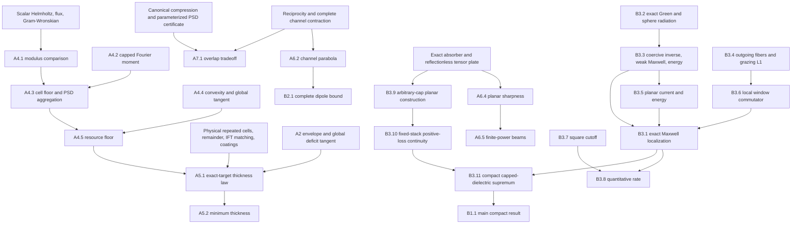

# Reconciled mathematical audit

**Main assessment:** no fatal error was found in the stated main results. Paper A's exact scalar Theorem 5.1 is supported by a complete existing kernel proof and exact statement correspondence. Paper A's full Theorem 7.1 and Paper B's actual Maxwell localization/compact supremum survive ordinary analytical and adversarial review, but are not fully formalized. Scientific priority remains a separate question.

The three separately written reviews are `audits/AUDIT_A_ANALYTICAL.md`, `AUDIT_B_COUNTEREXAMPLES.md`, and `AUDIT_C_MODEL_FIDELITY.md`. They were produced before this synthesis. Their agreement is AI-agent review, not external human peer review. The full manuscripts, including appendices and references, were read; key conjugations were visually checked. Sources remain unchanged and their provenance/hashes are in `reference_manifest.json`.

## Exact classes used below

**A2, scalar channel:** a complex symmetric 2×2 scattering matrix S with `I-S†S≥0`; transmitted power T=|t|², mean absorption a=(A_L+A_R)/2, signed half-difference δ=(A_L-A_R)/2, b=1-T-a. These are complete two ports.

**A4, selected scalar material:** k>0; finitely many ordinary scalar layers; p≤P and 0≤q≤Q on a selected interval J of length L>0, P,Q>0, loss integral M>0 on J; finite passive surroundings are allowed. This class has no stated lower bound p≥1 in Section 4. Let K=k√P, U=KM/Q, f(u)=u²-sin²u, g=√f, and `c=det(A)/T` for the complete stack. Transmission is nonzero for these finite scalar layers. The available Lean physical class globally requires p≥1, a genuine narrower class.

**A5, exact-target scalar material:** k>0, P>1, Q,M>0; global `1≤p≤P`, `0≤q≤Q`; every layer has finite thickness, all thicknesses and loss count; loss integral exactly M; exact target `0<T<1`, `0<a<(1-T²)/2`; thickness at most L. Write b=1-T-a, s=√(1-2a), y₀=s-T, x₀=√(b²-y₀²), D₀=2x₀, α=Ty₀/(sx₀). D*(L) is the real supremum over this class once nonempty. It is not an approximate-target class.

**A6/A7, channels:** complete power-normalized Hilbert channels; transpose-symmetric contraction S; transpose-symmetric unitary background S₀; unit input u and background reverse v=J₀u with `J₀u=overline(S₀u)`. A(u)=1-||Su||², C(u)=||(S-S₀)u||², X(u)=A+C. This dimensionless unit-power model is distinct from plane-wave cross sections of a compact body.

**B3, fixed Maxwell profile:** k,L>0; bounded open Lipschitz Ω of positive area; measurable complex 3×3 χ(z) with χᵀ=χ, `Im_Hχ≥δI`, and `||χ||≤K` for almost every z∈(0,L), with δ>0 and K fixed; µ=I, ε=I+χ within D_R=RΩ×(0,L), vacuum outside. Opposite waves are genuine time reverses `e exp(ikz)` and `bar(e)exp(-ikz)`, with transverse unit e. Complete scattering is the full sphere integral. No uniformity in χ,δ,L is stated.

**B1/B3.11, compact construction:** k>0, P>1, Q>0 fixed; each body consists of two adjacent finite homogeneous anisotropic layers with a finite square aperture, µ=I, εᵀ=ε, `I≤Re_Hε≤PI`, `0<Im_Hε≤QI`. There is no common size, thickness, volume, integrated loss, minimum-loss floor, or bandwidth bound. Γ is the absolute absorption-cross-section difference divided by the positive common extinction.

## Theorem-by-theorem ledger

Statuses refer to the **complete exact manuscript statement**, not its useful proved components. Exact declared component types and assumptions take precedence over informal name matches. Unavailable historical source is not credited.

| Result and location | Hypotheses beyond the classes above; exact conclusion | Main dependencies | Audit / formal status |
|---|---|---|---|
| A Proposition 2.1, p.4 | A2: feasibility iff `0≤T≤1`, `0≤a≤1-T`, `x=|δ|≤min(a,b)` and `a²-x²-2T(b-√(b²-x²))≥0` | 2×2 PSD criterion; optimal relative phase | Correct ordinary proof; PARTIALLY FORMALIZED (actual absorption determinant/active-envelope algebra available, complete iff and all endpoints not credited) |
| A Proposition 2.2, p.5 | A2: below `a_c=(1-T²)/2`, D₀=`2√[b²-(√(1-2a)-T)²]`; above, D₀=2b, with stated equality phases/endpoints | A2.1; decreasing phase-eliminated budget | Correct ordinary proof; PARTIALLY FORMALIZED (strict active target only in current scalar proof) |
| A Eq.19-21, pp.6-7 | Actual finite scalar solutions: absorption Gram, Wronskian pair determinant, `c=det(Σ-F†ΣF)` invariant under lossless unimodular coatings | Helmholtz/interface flux; Gram determinant; determinant-one transfer | Verified for the ordinary dielectric class used in A5; broader A4 physical scope PARTIALLY FORMALIZED |
| A Lemma 4.1, p.7 | A4 and 0≤h≤π/K inside J: `|s(x+h,x)|≥sin(Kh)/K` | Initial-value uniqueness; first-zero modulus comparison | Ordinary proof survives; PARTIALLY FORMALIZED for broader material class; `finitePhysicalStack_modulus_comparison` covers p≥1 |
| A Lemma 4.2, p.8 | Integrable real q, 0≤q≤Q, interval length≤π/K, mass m: `|∫q exp(2iKz)|≤(Q/K)sin(Km/Q)` | Positive-part cosine majorant; period integral | FULLY KERNEL VERIFIED by capped Fourier declarations for these integral/cap hypotheses |
| A Lemma 4.3, p.8 | Selected cells length≤π/K: `det A_cell/T≥(Q²/P²)f(Km_cell/Q)` and `√c≥(Q/P)Σg(u_cell)` | Gram-Wronskian; A4.1-2; PSD determinant Minkowski | Ordinary proof correct; PARTIALLY FORMALIZED for broader A4 class, PSD aggregation itself verified |
| A Lemma 4.4, p.8 | g convex on [0,π/2]; tangent at 0<x≤1/3 lies below g on [0,π] | Derivatives; H'=2f sin(2u); chord/upper slope bounds | FULLY KERNEL VERIFIED: `ResourceScalar.g_convex_half`, `g_tangent_full` |
| A Theorem 4.5, p.9 | A4; β_n=n²Q²f(U/n)/P². Half-cell n_h=max(1,ceil(2KL/π)): `c≥β_nh≥4k⁴M⁴/[3Q²(π+2k√P L)²]>0`. Full-cell n_f=max(1,ceil(KL/π)) floor holds if U≤π/2 or U/n_f≤1/3. Every fixed-resource sequence L_j→∞ has liminf `(kL_j)²c_j≥π²(kM)⁴/(3PQ²)` | A4.1-4; equal-cell partition; series at zero | Correct ordinary proof; PARTIALLY FORMALIZED for full A4. Existing `theorem45_finite`, `theorem45_uniform_asymptotic`, `theorem45_sequence_lowerlimit` require global p≥1 |
| A Remark 4.6, p.9 | Positive distributed loss: finite resource inequalities are strict, not attained | Nonzero imaginary Wronskian forcing on a positive-measure set | Ordinary proof; no complete general statement correspondence claimed |
| A Theorem 5.1, p.10 | A5: eventual nonempty class; every finite stack D<D₀; all-real-budget limit `(kL)²[D₀-D*(L)]→απ²(kM)⁴/(3PQ²)` | Restricted A4.5; global envelope tangent; repeated physical cells; exact IFT matching; bounded coatings; phase penalty; floor budget | FULLY KERNEL VERIFIED: `OQ7.theorem51` with exact A5 hypotheses; ordinary reconstruction also survives |
| A Corollary 5.2, p.13 | A5: L_min(η) is the infimum of actual thicknesses with D≥D₀-η; `kL_min(η)∼[π(kM)²/Q]√[α/(3Pη)]` as η↓0 | Uniform lower floor; actual constructed family; A5.1 | Correct ordinary implication; ORDINARY PROOF ONLY as a separate minimum-infimum statement |
| A Proposition 6.1, p.14 | A6: `X(u)=X(J₀u)` | Bilinear transpose reciprocity; unitary reference | ORDINARY PROOF ONLY for arbitrary Hilbert channels; historical 43-source not available |
| A Theorem 6.2, p.15 | A6: 0≤X≤4, `|A(u)-A(v)|=|C(u)-C(v)|≤X-X²/4`; every X attained by a reciprocal 3-channel contraction. Interior equality has one `Su=(1-X/2)S₀u` and other output norm one; endpoints both ±background | Norm expansion; Cauchy-Schwarz; exact Gram-defect witness | Correct ordinary proof; complete general/equality theorem not claimed kernel-verified |
| A Theorem 6.3, pp.16-17 | A2 with vacuum swap reference, X=2(1-Re t)>0: ratio≤`√(10√5-22)`; all equality matrices have the stated golden-ratio magnitudes and opposite reflection phases | Real-contraction reduction; fixed-X envelope; one-variable optimization; equality in reverse triangle | ORDINARY PROOF ONLY; dielectric sharpness additionally uses A5.1 and reflectionless phase slab |
| A Theorem 6.4, pp.18-19 | Fixed k>0,-1<t<1,η,h>0: two finite-coefficient but laterally infinite tensor layers give A_L=0, A_R=(1-t²)A_x>0, common X=2(1-t); η_m=1/m,kh_m=m² gives A_x→1. Every fixed 0<X<4 approaches X-X²/4. Generalized plate works for any P>1 | Exact 4-port Maxwell slab/plate synthesis; nonzero denominator; weak mismatch/strong attenuation limit | ORDINARY PROOF ONLY; infinite material extent, not compact Maxwell |
| A Corollary 6.5, pp.20-21 | Same infinite stacks; unit-power beams with **exact** common target 0<X<4 approach X-X²/4; free-X ratio supremum one | Oblique transfer continuity; nonsingular power basis; angular Parseval; IVT angle retuning; ordered diagonal limit | ORDINARY PROOF ONLY; finite power does not make material compact |
| A Theorem 7.1, pp.22-26 | A6,0<ρ=|⟨u,J₀u⟩|<1,0≤X≤4,r=|1-X/2|,dρ=√(1-ρ²): maximum dρ for r≤ρ/2; dρ(1-λ²)√(1-c²) for ρ/2<r<ρ, with unique c∈(0,ρ) solving r=(ρ+c-2ρc²)/(2-ρc-c²), λ=c(ρ-c)/(2-ρc-c²); 1-r² for r≥ρ. Complete transitions/equality as in pp.24-25 | Real canonical coordinates; B²≤Q≤I; PSD trace certificate; monotone r(c); plateau and three-channel witnesses | Correct ordinary proof; PARTIALLY FORMALIZED by the new exact signed rational SDP upper bound and attainment; generic historical certificate source unavailable; no full kernel theorem or local Maxwell equality realization |
| B Theorem 1.1, p.1 | B1: for every ε>0 a finite compact body gives positive common extinction and Γ>1-ε; hence supΓ=1, no individual regular positive-extinction attainment | B3.11; reciprocity/passivity; optical theorem | ORDINARY PROOF ONLY; actual compact Maxwell statement survives audit |
| B Theorem 2.1, pp.3-5 | Reciprocal electric-magnetic point dipole A obeying `Im_H A-A†A≥0`: `0≤σ_ext≤12π/k²`, `|Δσ_abs|≤σ_ext-k²σ_ext²/(12π)`; equality at each extinction, positive-extinction ratio strictly below one, free supremum one | Full sphere dipole radiation; magnetic reciprocity rotation; contraction bound/equality witness | ORDINARY PROOF ONLY; numerically/exactly checked components do not supply local dielectric completion |
| B Lemma 3.2, p.7 | B3 at each finite R: T_R bounded on L²(D_R) and exact all-angle positive radiation identity | Newtonian multiplier plus weak singular Schur remainder; Im g sphere representation | ORDINARY PROOF ONLY; no aperture-uniform T_R norm asserted |
| B Proposition 3.3, pp.7-8 | B3: unique VIE/outgoing weak Maxwell solution; `||L_R⁻¹||≤K²/δ`; exact energy and reciprocity identities | B3.2; W factorization; complex Lax-Milgram; outgoing convolution converse | Main Maxwell result ORDINARY PROOF ONLY; generic coercivity/error components partially formalized |
| B Lemma 3.4, pp.8-9 | B3: exact outgoing fibers incl longitudinal -I; fixed-interval norm bound and `||Tκ-T0||≤C0|κ|` below k/2 | Weyl representation; derivative jump; Schur kernel bounds | ORDINARY PROOF ONLY; grazing uses locally L¹ norm, not its square |
| B Proposition 3.5, p.9 | B3: unique planar q, complete two-direction amplitudes, A∞/C∞/X∞ and exact energy identity | Normal fiber; same strict-loss coercivity; exterior plane-wave coefficients | ORDINARY PROOF ONLY |
| B Lemma 3.6, pp.10-11 | Fixed g∈C_c∞(Ω),q∈H: `||T(g_Rq)-g_RT0q||_{L²(D_R)}=o(R)` | B3.4; low Fourier L²/high Fourier L¹ split; density and finite-domain boundedness | ORDINARY PROOF ONLY; false stronger global-L² assertion explicitly excluded |
| B Theorem 3.1, pp.6-11 | Exact B3: area-normalized extinction, absorption and **all-sphere** scattering converge to fixed planar values for both illuminations | B3.2-6; trial residual; uniform inverse; window-density order; bounded observables and both energy identities | ORDINARY PROOF ONLY; generic norm/observable components are not the physical theorem |
| B Lemma 3.7, p.12 | S_R square,0<w≤R/8: smooth interior cutoff with three boundary/gradient/fifth-derivative bounds | Explicit smooth product cutoff; strip geometry; scaling | ORDINARY PROOF ONLY |
| B Proposition 3.8, p.12 | Fixed B3 stack and square: current error O((kR)^(2/3)); area-normalized powers error O((kR)^(-1/3)), with fixed-stack constants | B3.7; five integrations by parts; low/high split; w=k⁻¹(kR)^(1/3) | ORDINARY PROOF ONLY; no uniform-loss or optimal-rate assertion |
| B Lemma 3.9, pp.13-14 | k>0,P>1,-1<t<1,η,h>0: finite planar two-layer tensor realization with real eigenvalues [1,P], exact powers and Γ=(1+t)A_x/2; sequence tends to one | A6.4 generalized plate; exact scalar absorber | ORDINARY PROOF ONLY; initially loss is semidefinite and geometry infinite |
| B Lemma 3.10, p.15 | One fixed finite B3.9 stack: ε→ε+iδI gives strict loss for δ>0 and scattering powers/Γ continuous at δ=0 | Finite tensor transfer exponentials; passive outgoing flux + ODE uniqueness; positive extinction | ORDINARY PROOF ONLY; never inverts singular χ at δ=0 |
| B Theorem 3.11, pp.15-16 | Exact B1 caps, every ε>0: compact local nonmagnetic dielectric Γ>1-ε, hence sup one | B3.9; choose finite stack; B3.10 fix δ; B3.1 choose finite R; upper bound/nonattainment | ORDINARY PROOF ONLY; no body-size or lossfloor uniformity assumed |

## Dependency graph

This graph is a mathematical dependency map, not a claim that its Maxwell nodes have Lean declarations. `LEAN_STATUS.md` records actual kernel coverage.

## Reconciliation of issues

1. **No fatal theorem failure found.** All branches support the exact ordinary B3.1 proof. The explicit distributional tensor reconstruction and outgoing homogeneous-difference uniqueness make the short cited analytical bridge complete; the isotropic VIE reference alone is insufficient.
2. **Formal statement-correspondence gap:** full A4.5 allows p<1 whereas the verified physical class excludes it. A passive p=1/2 layer lies in the paper's broader class but not the Lean class. This is a counterexample to asserted class equivalence, not to the determinant inequality. A5.1 requires p≥1, so its full formal proof remains valid.
3. **Expository clarification:** B's combined rate constant hides units. The localization report supplies separate dimensional constants/scaled lengths. No frequency-varying limit is asserted.
4. **Reproducibility/provenance limitation:** the distinct 43-theorem Lean 4.19 supplement and new author numerical archives were not recovered locally. Their reported results are not credited as reproduced. Conversely, the actual 692-theorem project is present and independently inventoried; Paper A's prior absence discussion is historical, not the current status.
5. **Unproved formal foundations:** Maxwell distributions, outgoing weak equivalence, Fourier fibers, sphere optical theorem, physical regularization and complete compact construction remain outside Lean. Full A7.1, including generic parameter uniqueness and equality reductions, also remains unfinished. The rational instance is not the full theorem.
6. **No realization gap concealed:** A7.1's sharp abstract equality matrices have no supplied local Maxwell realization at nonzero overlap. A6.4 and A6.5 establish different physical classes. Only B3.11 bridges to finite compact objects.

Two genuine counterexamples were derived against tempting stronger claims: a smooth compact source with nonzero grazing Fourier weight produces a globally non-L² transverse radiating commutator, and grazing trial currents give `||T_R||≥C√R`. The manuscript expressly avoids both stronger claims. A permitted planar longitudinal example also makes the inverse diverge as δ→0. These demonstrate why its local mixed norm and ordered limits are essential; they are not manuscript failures.

## Numerical evidence and limits

Independent stable cascades and finite 4×4 exponential boundary solves reproduce planar Γ_A=0.7821175026664408 and Γ_B=0.9180596086651859, with power differences below 3.34e-15. Exact symbolic middle-branch/rational certificates have zero remainders. An 80-digit exact-layer thickness benchmark at m=128 gives m² deficit 0.05000020535299 and m²c 0.08333269048662. A 12,000-sample complex-contraction falsification search found no violation.

Complete dipole sphere quadrature and small dense nonperiodic DDA agree with their radiation Gram expressions. DDA shows marked mesh sensitivity; no continuum error certificate exists. The manuscript's much larger FFT/GMRES production runs, including iteration-limit cases, were not independently rerun. Their printed failed-run residuals are not relabeled converged. See the independent script, complete JSON and Audit B for exact algorithms, versions and limitations.

## Dissemination consequence

The main ordinary compact-object claim survives this audit, but it should not be advertised as a kernel-verified Maxwell theorem. Preserve the source PDFs and attach a formal-status addendum rather than silently revising historical availability claims. No substantive correction to the mathematical theorem statements was found, so no replacement manuscripts are generated here. External mathematical review, explicit analytic bridge exposition, actual author source retrieval, and careful prior-art comparison remain needed before a publication claim is settled.
